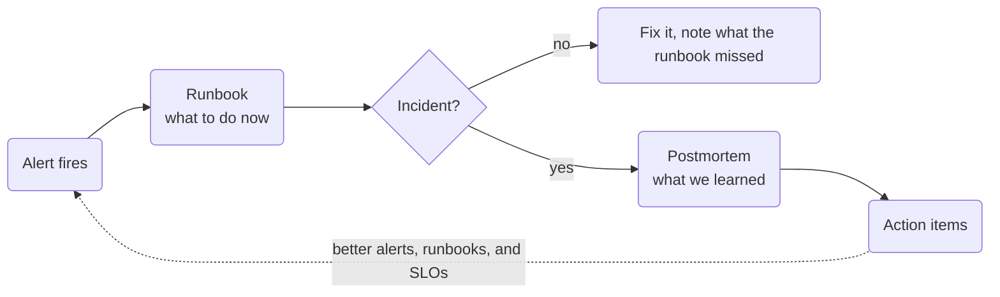

The [last post](/learning/2026/10/08/burn-rate-alerts.html) ended with an alert that pages me. That's only useful if I know what to do when it goes off, and if the team learns something once it's over. Those are two different documents, read at two different times: a runbook and a postmortem.

## The runbook

A runbook is written before the alert fires and read while it's firing. The person reading it was just woken up at 3am and may never have seen this alert before. So it's short, it starts with what the alert means and who it affects, and it gets to the first checks fast.

The SRE book puts a number on why it's worth writing one. Google found that writing down the best practices ahead of time in a playbook "produces roughly a 3x improvement in MTTR as compared to the strategy of 'winging it.'" That's from the [introduction](https://sre.google/sre-book/introduction/), and it was enough to convince me.

Here are the sections I settled on:

- What the alert means, in a sentence or two, and the condition that fires it
- Impact: who notices if this is real
- First checks: what to look at in the first 5 minutes, with the exact commands
- Likely causes, each with how to confirm it and which mitigation to jump to
- Mitigations, each with how to verify it worked, and a "Do not" line for anything risky
- Escalation, dashboards, and a history table at the bottom

Every likely cause points at a mitigation. That was the rule that made the template click for me. A runbook that lists causes without saying what to do about them just gives you more to read at 3am.

## The Pi-hole runbook

I wrote real ones for my Pi-hole alerts. The first two checks in [the runbook for the DNS probe](https://github.com/Mosher-Labs/homelab-gitops/blob/936ffc2ab4809d7f9b2bd443f4a49cc2c443b5e5/docs/runbooks/pihole_dns_burn.md) are:

1. Is DNS actually broken, or just the probe? `dig @192.168.87.101 example.com` from a laptop. If that answers, the alert is about the probe, and nobody in the house has noticed.
2. Is the Pi-hole pod running? `kubectl -n pihole get pods`, then `pihole status` inside it.

The first check is the one I'd have skipped without a runbook. When DNS alerts, my instinct is to restart Pi-hole. If the problem is the probe, that restart doesn't fix anything, and it adds a change to an outage I don't understand yet.

I ran every command in the runbooks against the cluster before I published them, and I found a couple of things I'd have gotten wrong from memory. Pi-hole has no persistent volume, so Kubernetes can move it to my other node. That only works while the control plane is up, though, and the control plane runs on the same node Pi-hole usually does. That went into the "Node down" section.

The template says one runbook per alert. I have six Pi-hole alerts, and I wrote four runbooks: one for the fast and medium alerts on each SLI, since those watch the same thing and only differ in speed, and a short one for each slow alert, which just opens a ticket. Four near-copies would have drifted apart the first time I edited one.

## Putting the link on the alert

A runbook nobody can find at 3am doesn't help, so each alert now carries a link to its runbook. I added a `runbooks` input to my [terraform-kubernetes-observability](https://github.com/Mosher-Labs/terraform-kubernetes-observability/tree/v0.18.1) module. It sets Grafana's `runbook_url` on each rule, and the Slack and Webex messages show the link next to the alert.

The module only links rules you list, so nothing points at a runbook that doesn't exist. It also has an output that lists every rule that pages and has no runbook. In my homelab that list is still long, and that's fine. It's a to-do list now instead of something I'd forget about.

My first release of this had a bug. If you gave a rule a full URL and no base URL, which is exactly what my homelab does, the plan failed. My tests always set both, so they never caught it. I fixed it in the next release and added the test I should have written the first time.

## The postmortem

A postmortem is written after an incident is over, and the team reads it. The SRE book's chapter on [postmortem culture](https://sre.google/sre-book/postmortem-culture/) lists when to write one:

- User-visible downtime or degradation beyond a threshold
- Data loss of any kind
- An on-call engineer had to step in, such as a rollback or rerouting traffic
- Resolution took longer than some threshold
- Monitoring failed, which usually means a person found the problem first

That last one stood out to me. If a person found it before the alert did, that's worth a postmortem even when the impact was small.

It has to be blameless. The book says a blameless postmortem focuses on the contributing causes and doesn't blame a person or team for doing something wrong. In practice, that means "the deploy tool allowed X", not "someone ran X by mistake".

My [postmortem template](https://github.com/Mosher-Labs/terraform-kubernetes-observability/blob/v0.18.1/docs/templates/postmortem.md) has a summary, the impact, a timeline, root causes, how long it took to notice, and what went well, what went badly, and where we got lucky. The impact section uses the error budget from the [first post](/learning/2026/10/06/slis-slos-and-error-budgets.html): "this used 18% of the 30-day budget" says more than "DNS was down for a while."

## Action items are the point

Everything else in the postmortem is there to get to the action items. Each one gets one owner, one tracking link, and a type:

| Type | What it does |
| --- | --- |
| Prevent | Stops the cause from happening again |
| Detect | Finds it sooner next time |
| Mitigate | Limits the impact when it does happen |
| Process | Changes how we respond |

A detect item usually turns into a new alert or a new SLI, which takes you back to the start of this series. I've already had one of those, without an incident. Some feedback from a LinkedIn comment on the last post pointed out that my DNS probe only asks for one name, so a real failure for other names could hide behind it. That's a detection gap. The fix was [a second SLI from Pi-hole's real replies](https://github.com/Mosher-Labs/homelab-gitops/pull/204), and it has its own runbook now too.

## The short version

A runbook is for the 5 minutes after an alert fires. A postmortem is for the week after an incident. The runbook gets you to a fix, and the postmortem's action items make the next alert, runbook, or SLO better.

The sources are the SRE book's [introduction](https://sre.google/sre-book/introduction/) and [postmortem culture](https://sre.google/sre-book/postmortem-culture/) chapters, and the Workbook's chapter on [postmortem culture](https://sre.google/workbook/postmortem-culture/). The templates are in the [module's docs](https://github.com/Mosher-Labs/terraform-kubernetes-observability/tree/v0.18.1/docs/templates).
