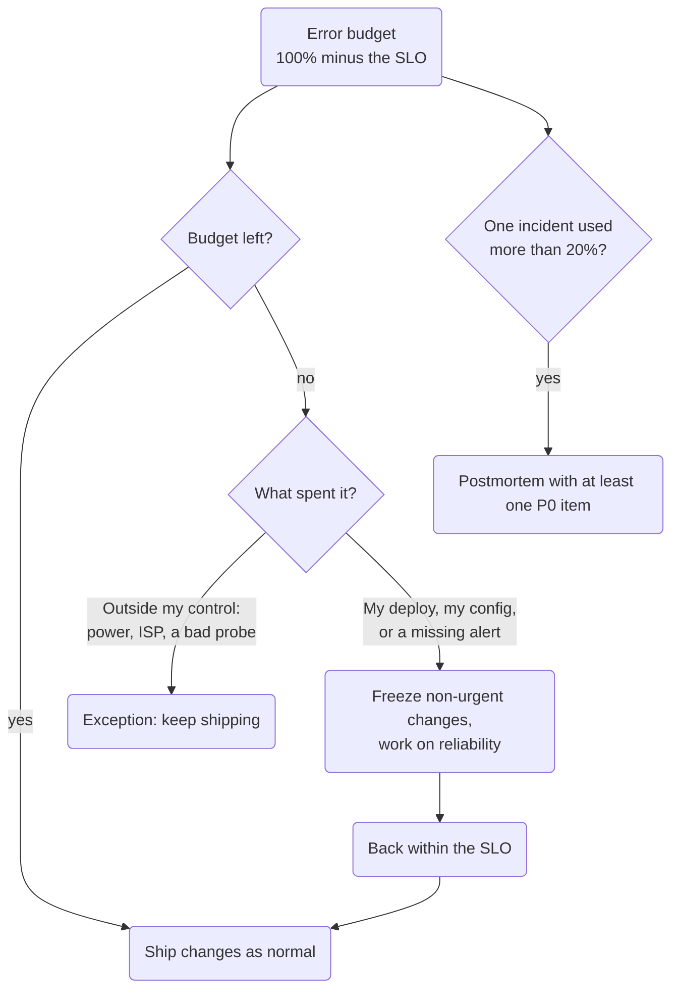

The first three posts in this series covered the [budget](/learning/2026/10/06/slis-slos-and-error-budgets.html), the [alerts on it](/learning/2026/10/08/burn-rate-alerts.html), and the [runbooks and postmortems](/learning/2026/10/11/runbooks-and-postmortems.html) that follow an alert. There's one question left: what do I do differently once the budget is gone? The answer goes in an error budget policy, and without one an SLO is just a graph.

## What the policy does

The SRE book's chapter on [embracing risk](https://sre.google/sre-book/embracing-risk/) says the error budget "removes the politics from negotiations" between the people who want to ship and the people who want to keep the service up. The policy is how that works. You agree on the rule ahead of time, so when the budget runs out nobody has to argue about whether to slow down.

The Workbook has an [example policy](https://sre.google/workbook/error-budget-policy/), and its non-goals section is my favorite part: "Halting change is undesirable; this policy gives teams permission to focus exclusively on reliability when data indicates that reliability is more important than other product features." It's not a punishment. It's permission.

The example has a few parts, and I used all of them:

- What happens while the budget isn't spent: releases proceed as normal
- What happens once it is: halt everything except P0 issues and security fixes until the service is back within its SLO
- Which causes must send you to reliability work, and which let you keep shipping
- A threshold for when one incident needs a postmortem
- Who decides when people disagree
- A date to review the policy again

The "must" and "may" lists are the part that made it click for me. If my own deploy or config caused the outage, I have to work on reliability. If the internet went down, that was the ISP, and freezing my changes wouldn't fix it.

An exception only decides whether I freeze changes. It doesn't mean I ignore the cause. The policy has a quarterly rule: if one kind of outage uses more than 20% of the budget over a quarter, a P0 item goes on the next quarter's plan. If the ISP keeps spending my budget, that item is a backup connection. At a company, it would be a ticket to add a second ISP.

## The numbers for Pi-hole

My Pi-hole SLO is 99.9% over a rolling 30 days, with a probe every 10 seconds. The policy needs numbers I can check against a graph, so here they are.

| | Probe SLI | Real-query SLI |
| --- | --- | --- |
| Events in 30 days | 259,200 probes | about 450,000 replies |
| Budget (0.1%) | 259 failed probes, or 43.2 minutes | about 450 SERVFAIL or REFUSED replies |
| 20% of the budget | about 52 failed probes, or 8.6 minutes | about 90 bad replies |

The probe is easy to say out loud, because 43 minutes of downtime a month means something to me. The reply count is what the book recommends, since it counts requests and not minutes. The Workbook's example does the same arithmetic: a million requests with a 99.9% SLO leaves a budget of 1,000 errors.

Here's a made-up example. A bad deploy fails probes for 12 minutes on one day, and nothing else has failed this month.

1. 12 minutes is 28% of the 43.2-minute budget.
2. The budget isn't spent, so there's no freeze.
3. It's over 20%, so the policy still requires a postmortem with at least one P0 action item.

I didn't expect that third result. I'd been thinking of the policy as a switch that flips when the budget hits zero. The postmortem threshold is separate, and one bad day can cross it long before the budget is gone.

## What I found when I read it again

I wrote the first version of this policy on October 6, along with the SLO document. When I went back to it for this post, I found four problems.

1. **It was never approved.** The "Approved on" field still said "Not yet". I read it again after fixing the rest and approved it on November 8.
2. **I missed the review date.** I'd set it to November 6 and asked for monthly reviews while the SLO is new. That date passed two days before I read it.
3. **It was missing two sections from the template.** I'd left out the non-goals and who decides when there's a disagreement. I'm the only person who runs the cluster, so I decide, and now the policy says so. That sounds silly, but a policy that doesn't say who decides is the kind that gets skipped.
4. **It didn't say what Renovate does.** My cluster gets dependency update PRs every day, and the policy says to stop "non-urgent changes." I'd never decided whether a Renovate bump is one. It is. During a freeze, the PRs for the affected service and what it depends on stay open until the freeze ends, unless they're security updates. The rest keep merging.

There's a smaller one too. Pi-hole has two SLIs, so it has two budgets. The policy now says the service has spent its budget when either one has.

The changes are in [the policy](https://github.com/Mosher-Labs/homelab-gitops/blob/main/docs/slos/error-budget-policy.md).

## What I haven't tested

I've never triggered this policy. The alerts have been failure-tested, so I know they fire and resolve, but the freeze itself hasn't happened. I don't know whether "leave the Renovate PRs open" is easy to follow when the pull requests pile up, or whether I'd just merge them anyway. One person writing a policy, approving it, and being frozen by it is also a weak setup, because nobody else would notice if I ignored it. For a homelab, that's fine. For a team, it's the reason the book wants product, development, and on-call to all sign it.

## Update: the alert fired seven minutes after I published this

I merged this post at 6:11 am on November 9. At 6:18 am, the medium burn alert for the Pi-hole replies SLO went off in Slack. It was the first real alert since I tested them, so the section above is already out of date.

The cause wasn't Pi-hole. A work laptop on its own VLAN was using Pi-hole for DNS, because the VLAN's DHCP settings pointed there. Every few minutes, it asked for one reverse lookup that fails on every resolver I tried: 1.1.1.1, 9.9.9.9, and 1.1.1.1 with DNSSEC checking off. The runbook's first checks found it in a few minutes, because one client and one name made 19 of the last 21 bad replies.

The alert made it look smaller than it was. Here are the 30-day numbers, from both Prometheus and Pi-hole's own database:

| | Bad replies | Share of the budget |
| --- | --- | --- |
| Budget (0.1% of 766,817 replies) | about 767 | 100% |
| Everything, as measured | 1,676 | about 219% |
| From the one lookup | 1,417 | about 185% |
| Everything else | 259 | about 34% |

Without that one lookup, the SLO would have held. The laptop also sends most of the traffic, which is why the table above assumed 15,000 queries a day and the real number is closer to 25,000. The ratios hold, but the budget is 767 bad replies, not 450.

Two things I haven't figured out. First, the rule's own math says the medium condition was true for about 24 hours on November 8, and my first Slack message was on November 9. I replayed the rule against the stored metrics to check that. I haven't seen Grafana's alert history yet, so I don't know whether the alert fired and I missed it or didn't fire at all. Second, I assumed the work VLAN couldn't reach the rest of my network, and a ping from my main LAN succeeded before I changed anything. I'm checking that next.

I fixed the DNS setting in UniFi and renewed the laptop's lease, and it stopped sending queries to Pi-hole. One incident used far more than 20% of the budget, so the policy requires a postmortem. The draft, with the action items and the open questions, is in [this pull request](https://github.com/Mosher-Labs/homelab-gitops/pull/257).

## The short version

The SLO tells you how much unreliability is acceptable, the alerts tell you when you're spending it, and the policy tells you what to do when it's gone. Write it before you need it, put numbers in it, name the causes that let you keep shipping and the ones that don't, and give it a review date you'll actually keep.

The sources are the SRE book's [embracing risk](https://sre.google/sre-book/embracing-risk/) chapter and the Workbook's [example error budget policy](https://sre.google/workbook/error-budget-policy/). The template is in the [module's docs](https://github.com/Mosher-Labs/terraform-kubernetes-observability/blob/main/docs/templates/error-budget-policy.md).
